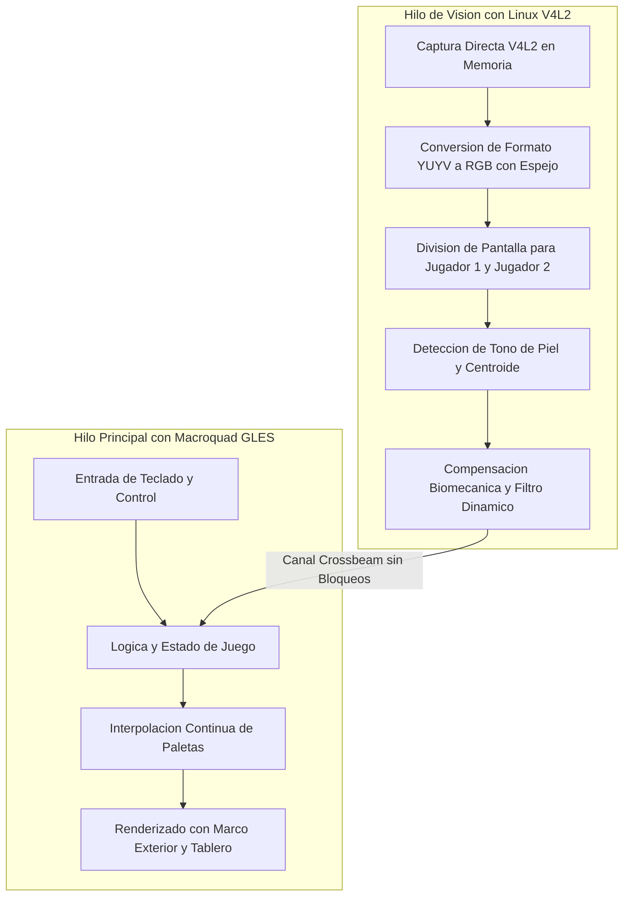

# FacePong: Pong Interactivo por Visión Artificial en Raspberry Pi 4

[](https://github.com/AndresRuzT/FacePong-Raspberry/actions/workflows/ci.yml)
[](https://www.rust-lang.org/)
[](https://www.python.org/)
[](https://opensource.org/licenses/MIT)

FacePong transforma el legendario juego arcade Pong en una experiencia interactiva sin contacto físico. Mediante visión artificial y estimación de inclinación cefálica en tiempo real, dos participantes compiten frente a una única cámara web conectada a una computadora de placa reducida.

El proyecto está concebido y optimizado para la Raspberry Pi 4 Model B, combinando alta fluidez visual, baja latencia y un consumo sumamente eficiente de energía.

Para brindar la mayor flexibilidad tanto a la comunidad académica como a desarrolladores de software, este repositorio cuenta con dos implementaciones complementarias:

1. Motor Nativo en Rust: La opción principal de alto rendimiento, diseñada con Macroquad y acceso directo al controlador V4L2 del núcleo Linux para aprovechar al máximo la aceleración gráfica por hardware.
2. Motor de Referencia en Python: Una alternativa orientada a investigación, simulación en computadoras personales y experimentación rápida mediante Pygame y MediaPipe.

Para conocer instrucciones paso a paso sobre cómo jugar, calibrar la cámara y solucionar dudas habituales, te invitamos a consultar la [Guía de Usuario en Inglés](file:///home/andres/Documents/OwnProjects/FacePong-Raspberry/USER_GUIDE.md).

## Aspectos Destacados del Proyecto

1. Motor Nativo de Alto Rendimiento: Desarrollado en Rust con Macroquad para renderizado fluido a más de 60 fotogramas por segundo mediante GLES 2.0 y captura de video sin copias innecesarias en memoria.
2. Control Gestual sin Contacto: Cada jugador desplaza su paleta verticalmente con el cabeceo e inclinación natural de su rostro, sin necesidad de sujetar mandos o periféricos adicionales.
3. Partición Inteligente de Cámara: El software divide el flujo de una única cámara USB en dos mitades horizontales con efecto espejo, permitiendo que ambos jugadores compartan el mismo sensor.
4. Seguimiento Submilisegundo: Detección de tono de piel en espacio de color YCbCr y cálculo de centroide en punto fijo, optimizado para procesadores ARM Cortex A72.
5. Compensación Biomecánica: Aplica una ganancia vertical diferenciada que equilibra la movilidad natural del cuello humano, permitiendo alcanzar las esquinas del campo de juego con comodidad.
6. Filtro Adaptativo de Señal: Suavizado exponencial dinámico que suprime temblores involuntarios cuando el usuario está quieto y responde de inmediato ante movimientos rápidos.
7. Tablero Desacoplado: Panel superior independiente que muestra la transmisión de video, el estado de detección y los marcadores sin interferir en la cancha de juego.
8. Modo Manual de Respaldo: Permite alternar a controles de teclado en cualquier momento para labores de depuración o juego en equipos que no dispongan de cámara.

## Arquitectura del Sistema

El siguiente diagrama ilustra cómo se coordinan los hilos de procesamiento visual y renderizado gráfico dentro del motor nativo:



## Requisitos del Sistema

### Plataforma de Hardware
1. Raspberry Pi 4 Model B con 2 GB, 4 GB o 8 GB de memoria RAM.
2. Disipador de calor activo o ventilador para mantener una temperatura óptima de operación.
3. Cámara web USB compatible con el estándar UVC y formato YUYV o MJPEG.
4. Monitor o televisor con conexión HDMI y resolución sugerida de 1280 por 720 píxeles.

### Entorno de Software
1. Sistema operativo Raspberry Pi OS Bookworm o Trixie de 64 bits.
2. Compilador de Rust versión 1.75 o superior junto con Cargo.
3. Python versión 3.11 o superior para ejecutar el motor de referencia o las pruebas de calidad.
4. Paquetes del sistema: libgl1, libegl1, libasound2-dev, libv4l-dev y pkg-config.

## Instalación y Puesta en Marcha

### Opción 1: Compilación y Ejecución del Motor Nativo en Rust

Esta es la alternativa recomendada para disfrutar la máxima velocidad en Raspberry Pi:

1. Clonar este repositorio en tu equipo:
```bash
git clone https://github.com/AndresRuzT/FacePong-Raspberry.git
cd FacePong-Raspberry
```

2. Preparar el sistema e instalar dependencias con el script automatizado:
```bash
chmod +x scripts/setup_rpi.sh
./scripts/setup_rpi.sh
```

3. Compilar el binario optimizado:
```bash
cargo build --release
```

4. Iniciar el juego:
```bash
cargo run --release
```

### Opción 2: Ejecución del Motor de Referencia en Python

Si deseas ejecutar FacePong en tu estación de trabajo para labores de investigación o diseño de algoritmos:

1. Crear y activar un entorno virtual:
```bash
python3 -m venv .venv
source .venv/bin/activate
```

2. Instalar las librerías indicadas en el archivo de requerimientos:
```bash
pip install -r requirements.txt
```

3. Iniciar la aplicación:
```bash
python -m facepong.main
```

## Controles del Juego

| Acción | Jugador 1 (Izquierda) | Jugador 2 (Derecha) |
| :--- | :--- | :--- |
| Control por Visión | Inclinar la cabeza arriba o abajo | Inclinar la cabeza arriba o abajo |
| Control por Teclado | Teclas W y S | Flechas Arriba y Abajo |
| Iniciar o Pausar | Barra Espaciadora | Barra Espaciadora |
| Recalibrar Centro Facial | Tecla C | Tecla C |
| Reiniciar Marcador | Tecla R | Tecla R |
| Salir de la Aplicación | Tecla Escape | Tecla Escape |

## Pruebas Automatizadas

El proyecto mantiene altos estándares de calidad con pruebas tanto para el código en Rust como para los módulos en Python.

1. Para ejecutar las pruebas unitarias del motor en Rust:
```bash
cargo test
```

2. Para ejecutar las pruebas de cobertura y análisis estático en Python:
```bash
pytest
```

## Documentación Adicional y Licencia

Para consultar instrucciones completas de uso pensadas para cualquier usuario o jugador, lee nuestro documento [USER_GUIDE.md](file:///home/andres/Documents/OwnProjects/FacePong-Raspberry/USER_GUIDE.md).

Este proyecto es código abierto y está disponible bajo los términos de la Licencia MIT. Para mayores detalles, consulta el archivo [LICENSE](file:///home/andres/Documents/OwnProjects/FacePong-Raspberry/LICENSE).
