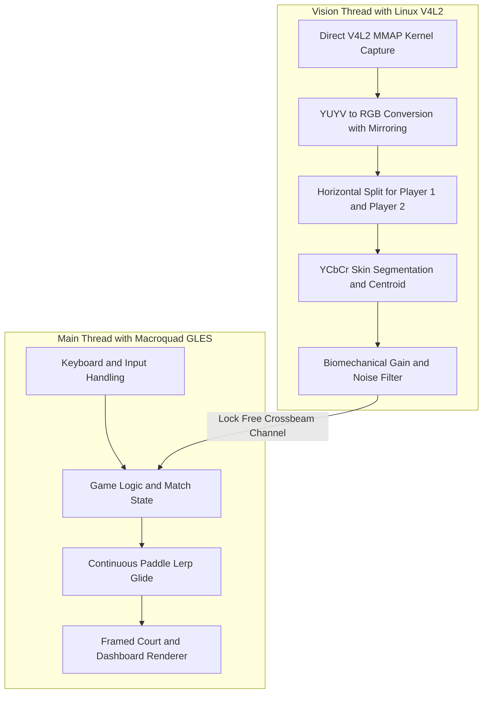

# FacePong: Real Time Vision Controlled Pong on Raspberry Pi 4 (In development).

[](https://github.com/AndresRuzT/FacePong-Raspberry/actions/workflows/ci.yml)
[](https://www.rust-lang.org/)
[](https://www.python.org/)
[](https://opensource.org/licenses/MIT)

FacePong transforms the classic arcade game Pong into a contactless, interactive experience. Using computer vision and real time head pose estimation, two participants compete using a single USB webcam connected to a compact single board computer.

The system is built and optimized specifically for the Raspberry Pi 4 Model B, pairing high visual fluidity, minimal latency, and energy efficiency.

To provide complete flexibility for both academic researchers and software engineers, this repository provides two complementary implementations:

1. Native Rust Engine: The primary high performance choice, built with Macroquad and direct Linux V4L2 kernel streaming to take full advantage of hardware graphics acceleration.
2. Reference Python Engine: An accessible environment tailored for research experimentation, desktop testing, and rapid prototyping using Pygame and MediaPipe.

For step by step instructions on setup, camera alignment, and gameplay, please visit the complete [USER_GUIDE.md](file:///home/andres/Documents/OwnProjects/FacePong-Raspberry/USER_GUIDE.md).

## Key Highlights

1. High Performance Native Engine: Crafted in Rust using Macroquad for hardware accelerated rendering at over sixty frames per second with zero copy video capture.
2. Contactless Gestural Control: Each player glides their paddle vertically through natural head tilt, without holding controllers or wearing markers.
3. Single Camera Dual Player Tracking: The vision worker automatically splits a single camera feed horizontally with a mirror effect, enabling two players to share one sensor.
4. Submillisecond Skin Tracking: Fast YCbCr color segmentation and fixed point centroid math optimized specifically for ARM Cortex A72 processors.
5. Biomechanical Angle Compensation: Applies a targeted vertical gain multiplier to match human neck anatomy, making it effortless to reach both corners of the court.
6. Adaptive Signal Filtering: Dynamic exponential smoothing removes resting tremor while delivering immediate paddle response during swift gestures.
7. Decoupled Dashboard: An independent top bezel displays the live video preview, match telemetry, and connection status without covering the court.
8. Manual Keyboard Fallback: Seamless keyboard controls let you debug game physics or play matches even when no camera hardware is attached.

## System Architecture

The following diagram illustrates how video acquisition and scene rendering cooperate smoothly within the native engine:



## System Requirements

### Hardware Requirements
1. Raspberry Pi 4 Model B with 2 GB, 4 GB, or 8 GB RAM.
2. Active cooling heatsink or fan to sustain cool operating temperatures.
3. Standard USB webcam with UVC support and YUYV or MJPEG output.
4. HDMI display or television supporting at least 1280 by 720 resolution.

### Software Requirements
1. Raspberry Pi OS Bookworm or Trixie sixty four bit edition.
2. Rust compiler version 1.75 or newer with Cargo.
3. Python version 3.11 or newer for running the reference engine and test suite.
4. Essential system libraries: libgl1, libegl1, libasound2-dev, libv4l-dev, and pkg-config.

## Installation and Getting Started

### Option 1: Native Rust Engine (Recommended for Raspberry Pi)

Follow these steps to compile and launch the high performance build:

1. Clone this repository to your machine:
```bash
git clone https://github.com/AndresRuzT/FacePong-Raspberry.git
cd FacePong-Raspberry
```

2. Prepare system packages and configure camera permissions:
```bash
chmod +x scripts/setup_rpi.sh
./scripts/setup_rpi.sh
```

3. Compile the release binary:
```bash
cargo build --release
```

4. Launch the game:
```bash
cargo run --release
```

### Option 2: Reference Python Engine (Ideal for Desktop Development)

If you wish to run FacePong on a workstation for algorithm research or custom modifications:

1. Create and activate a virtual environment:
```bash
python3 -m venv .venv
source .venv/bin/activate
```

2. Install the required Python packages:
```bash
pip install -r requirements.txt
```

3. Launch the game:
```bash
python -m facepong.main
```

## Game Controls

| Action | Player 1 (Left) | Player 2 (Right) |
| :--- | :--- | :--- |
| Head Tracking | Tilt head up or down | Tilt head up or down |
| Keyboard Controls | W and S keys | Up and Down arrow keys |
| Start or Pause Match | Space bar | Space bar |
| Recalibrate Center | C key | C key |
| Reset Score | R key | R key |
| Quit Application | Escape key | Escape key |

## Automated Verification and Tests

The repository includes dedicated test suites for both Rust and Python engines.

1. To run native Rust unit tests:
```bash
cargo test
```

2. To run Python test coverage and lint checks:
```bash
pytest
```

## Documentation and License

For comprehensive player guidance, calibration tips, and troubleshooting steps, read our [USER_GUIDE.md](file:///home/andres/Documents/OwnProjects/FacePong-Raspberry/USER_GUIDE.md).

This project is open source software distributed under the MIT License. Please refer to [LICENSE](file:///home/andres/Documents/OwnProjects/FacePong-Raspberry/LICENSE) for complete terms.
